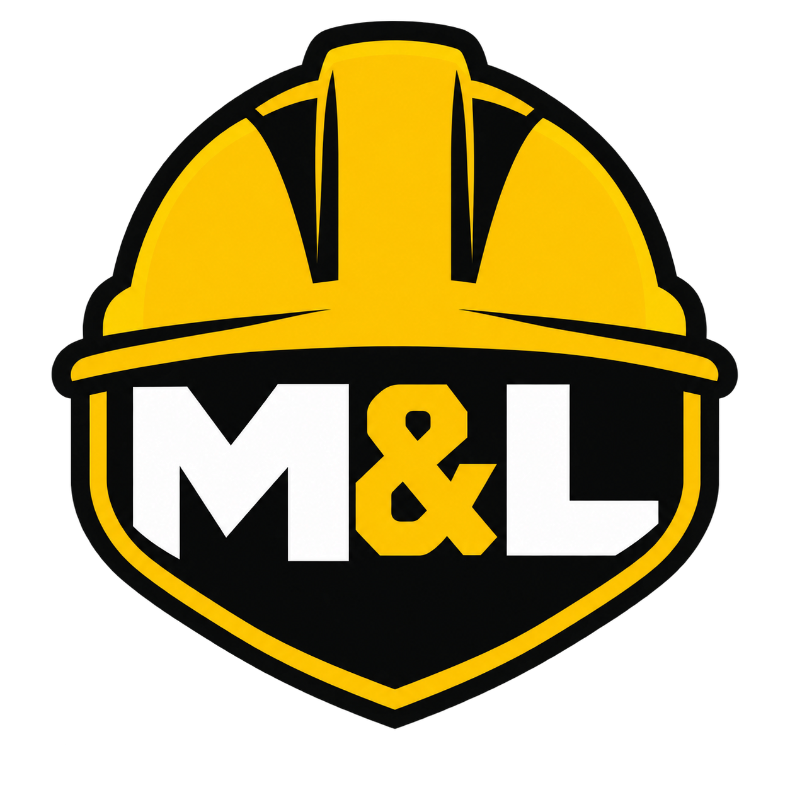
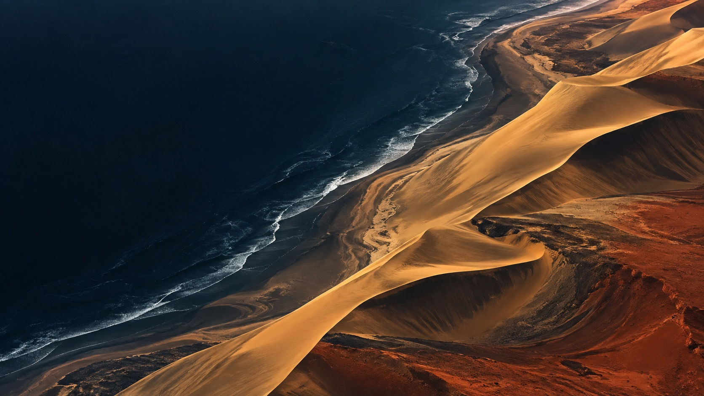

  

<h1 align="center">M & L Occupational Safety — Digital Experience Case Study</h1>

  <a href="https://ml-occupational-safety.pages.dev/"><strong>Open the live experience ↗</strong></a>
  &nbsp;·&nbsp;
  <a href="https://www.solarspin-namibia.xyz/">SolarSpin Technologies ↗</a>

A public design and engineering case study for the M & L Occupational Consulting Agents website: a bold, mobile-hardened occupational health and safety experience created in Windhoek, Namibia.

## The brief

Turn a dense business overview and an early poster-style identity into a credible public presence that makes workplace safety feel practical, immediate and distinctly Namibian.

## Scope

- Brand identity refinement and responsive logo system
- Content architecture and business positioning
- Responsive website design and frontend development
- Occupational safety service and engagement storytelling
- Mobile hardening down to 320px viewports
- Performance, accessibility and reduced-motion treatment
- Static export and Cloudflare Pages deployment

## Design direction

The experience combines safety yellow, near-black industrial typography and precise operational layouts with a cinematic Namib Desert–Atlantic coastline image. Restrained national colour accents and dune-contour textures root the work in Namibia without turning the interface into a literal flag treatment.

## Public-safe repository

This repository contains the public case study only. The production application source remains in a private repository. Client documents, private working files and deployment credentials are excluded.

## Credits

Creative direction, identity refinement, experience design and implementation by **[SolarSpin Technologies](https://www.solarspin-namibia.xyz/)**, led by Freeman Ipumbu in Windhoek.

## Licence

The case-study code is available under the MIT License. The M & L name, identity and imagery remain the property of their respective owner and are not licensed for reuse.

---

<strong>A Digital Experience by <a href="https://www.solarspin-namibia.xyz/">SolarSpin Technologies</a>.</strong>

